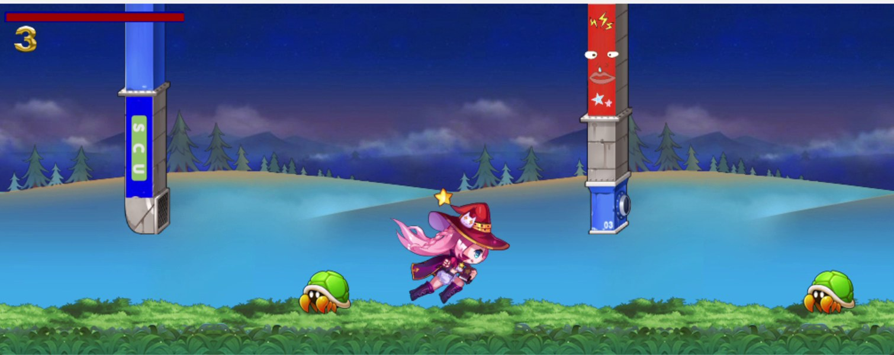
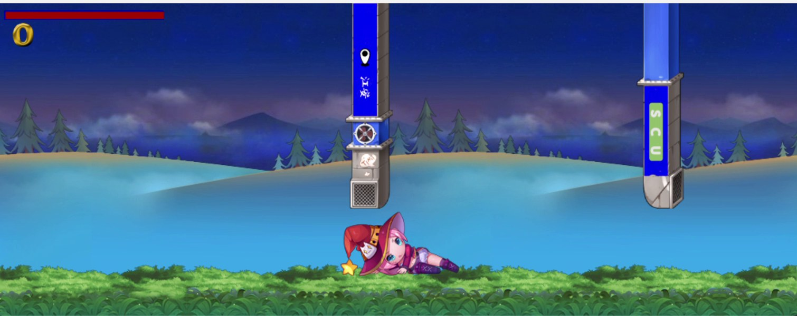

# 夜跑江安 · CampusRunning


四川大学江安校区主题的横版跑酷小游戏，C++ 课程设计作品。

玩家操控一名小魔女在江安的夜色里不停奔跑，跳过乌龟和狮子、蹲下钻过悬空灯柱，坚持到 10 分通关。

## 玩法

- 角色自动向前奔跑，障碍物从右侧随机出现。
- 初始血量 100，撞到障碍物会扣血，血量归零则游戏结束。
- 每安全通过一个障碍物得 1 分，累计 **10 分**通关。
- 游戏结束或通关后，在控制台按任意键即可重新开始。

| 障碍物 | 扣血 | 应对方式 |
| --- | --- | --- |
| 乌龟 | 5 | 跳过去 |
| 狮子 | 20 | 跳过去（会加速靠近） |
| 悬空灯柱 | 20 | 下蹲钻过去 |

## 操作

| 按键 | 动作 |
| --- | --- |
| ↑ | 跳跃 |
| ↓ | 下蹲 |

> 程序启动、死亡和通关时调用了 `system("pause")`，需要在控制台窗口按一次键才能继续。

## 功能实现

- **三层视差背景**：天空、远山、草地分别以 1 / 2 / 4 像素每帧的速度滚动，首尾循环拼接。
- **帧动画**：12 帧奔跑动画，配合跳跃与下蹲状态切换。
- **随机障碍物**：最多同时存在 10 个，生成间隔在 50–99 帧之间随机。当灯柱刚出现在屏幕右侧时不会紧接着生成狮子，避免出现无法躲避的组合。
- **碰撞检测**：玩家与障碍物各取一个向内收缩的矩形做 AABB 相交判断。
- **透明贴图**：读取 EasyX 图像缓冲区，按 alpha 混合公式逐像素绘制 PNG，见 `tools.cpp` 中的 `putimagePNG`。
- **双缓冲绘制**：`BeginBatchDraw` / `EndBatchDraw`，避免画面闪烁。
- **界面与音效**：血条、数字分数、循环背景音乐，以及碰撞、胜利、失败音效（MCI 播放）。
- **定时刷新**：`getDelay()` 累计到 30ms 触发一次逻辑更新。

## 游戏截图

**跳跃越过乌龟**



**下蹲钻过灯柱**



**通关画面**


## 演示视频

[游戏展示.mp4](游戏展示.mp4)

## 技术栈

- C++（Visual Studio 2022，v143 工具集）
- [EasyX](https://easyx.cn) 图形库
- Win32 API + MCI（`winmm.lib`）音频播放

## 目录结构

```text
夜跑江安/
├─ main.cpp                    # 游戏主循环与全部游戏逻辑
├─ tools.h
├─ tools.cpp                   # 透明贴图、矩形碰撞、计时、音效、血条
├─ 夜跑江安.sln
├─ 夜跑江安.vcxproj
├─ 夜跑江安.exe                # 预编译的 64 位版本
├─ res/                        # 图片、音乐与音效
├─ docs/screenshots/           # README 截图
├─ 游戏展示.mp4                # 演示视频
└─ README.md
```

## 运行

### 安装包

从 [Releases](https://github.com/Fresh0077/CampusRunning/releases) 下载 `CampusRunning-Setup-v1.0.0.msi`，双击安装。安装程序已内置 VC++ 运行库，完成后从桌面或开始菜单的「夜跑江安~Campus Running!」启动即可。

### 直接运行

克隆仓库后双击根目录下的 `夜跑江安.exe`。先在控制台窗口按一次键进入游戏，再切到游戏窗口用方向键操作。

程序通过相对路径 `res/...` 读取资源，因此 `夜跑江安.exe` 必须和 `res` 文件夹放在同一目录。如果提示缺少 `VCRUNTIME140.dll`，安装微软官方的 VC++ 2015–2022 运行库即可。

### 从源码编译

1. 安装 Visual Studio 2022，勾选“使用 C++ 的桌面开发”工作负载。
2. 安装 EasyX 图形库（<https://easyx.cn>，安装时选择对应的 Visual Studio 版本）。
3. 打开 `夜跑江安.sln`，选择 `x64` 平台、`Release` 配置，生成解决方案。
4. 把 `res` 文件夹复制到 exe 所在目录后运行。

## 说明

- 课程设计作品，仅供学习和交流；游戏图片与音乐素材来源于网络，版权归原作者所有。
- 作者：程思伟
